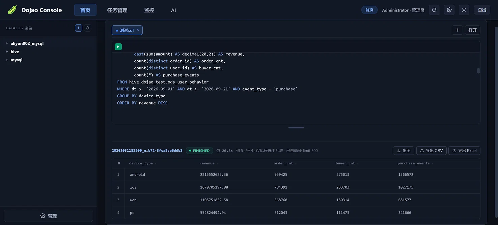
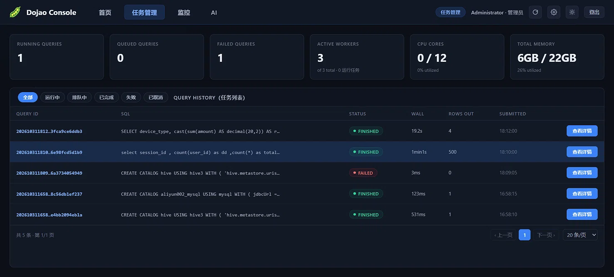
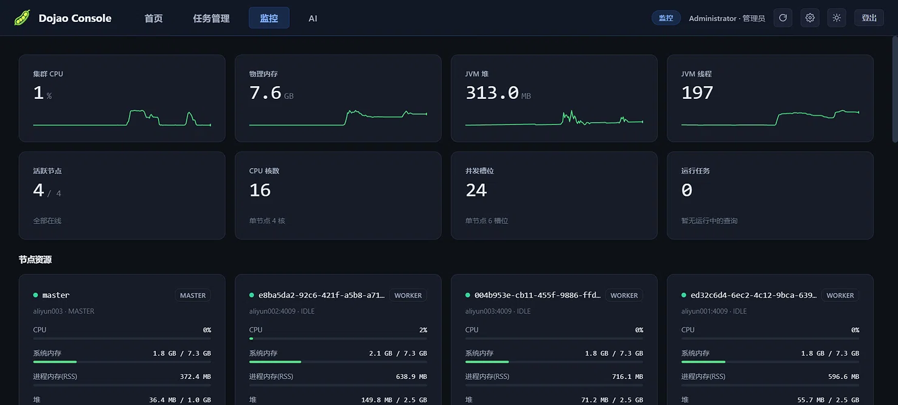
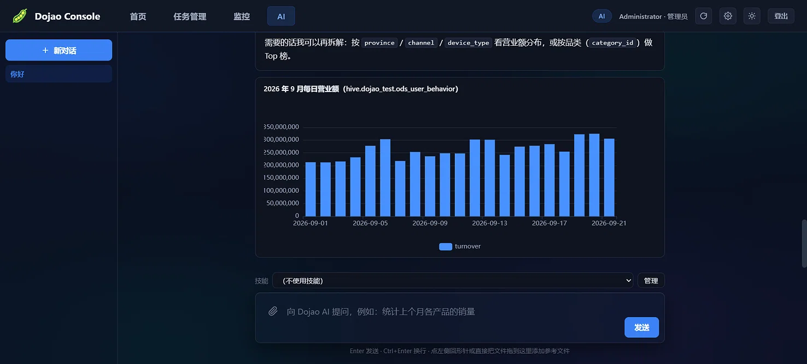

# Dojao

**打破数据库之间的隔阂 —— 面向 AI 时代的数据科学计算引擎**

[English](README.en.md) | 中文

[](https://github.com/Jason1008Jia/Dojao/actions/workflows/maven.yml)
[](LICENSE)
[](https://jdk.java.net/21/)
[](https://www.python.org/)
[](https://arrow.apache.org/docs/format/Flight.html)

---

## 简介

Dojao 不是一个数据库，也不只是一个查询引擎。它是一个**面向数据科学家和分析师的分布式计算引擎**，能力分两层：

- **SQL 层**：一条 SQL 里同时完成 **跨源联邦查询** 与 **Python 向量化计算**（Python 以 UDF / UDAF 的形式注册成
  SQL 函数），**不需要搬迁数据**；
- **AI 层**：Web 控制台内置流式 ReAct Agent，用自然语言完成取数、执行 SQL 与出图。
  AI 在**控制台**里，不是 SQL 语法的一部分（引擎本身没有 AI 函数）。

设计初衷只有一句话：**让分析师用一条 SQL 打通散落在 MySQL / TiDB / Doris / PostgreSQL / SQL Server / Oracle /
Hive / ClickHouse / Excel 里的数据，让数据科学家不写一行 JVM 语言就能把 Python 统计量 / 小模型直接当 SQL 函数用。**

配套：**单进程即可跑通**（Master + Worker 同进程），也能**独立组集群**（Master / Worker，Arrow Flight 传输）；
聚合 / 窗口 / 排序 / 排序归并 Join **自动溢写磁盘**；**算子自观测**，内置 Web 控制台看每一次查询的进度、内存与溢写。

> 当前版本 `0.1.0`：核心能力可用（联邦查询 / 溢写 / 分布式执行 / Python UDF / AI 控制台），
> 已知边界集中在 [「已知边界」](#已知边界-limitations) 一节，建议先读再评估是否适配你的场景。

---

## 为什么是 Dojao（核心差异化）

1. **确定性优先于峰值性能** —— 大表 Join 场景下，「能跑完」比「跑得快」重要。
2. **磁盘辅助是一等公民** —— 统一的溢写管线（P1 攒 + 溢写 / P1.5 归并 / P2 输出），由
   GroupBy / Window / Sort / SortMergeJoin 四类算子共享（HashJoin 为内存驻留，见「已知边界」）；
   **溢写是「减量」的**：窗口 `rn=1` 溢写时即按组裁到 N 行，高基数 GROUP BY 用 K 路归并（峰值内存与 key 总数无关）。
3. **跨源向量计算** —— 向量列（如 pgvector）映射为 Arrow `FixedSizeList<Float32>`，
   `cosine_similarity / l2_distance / inner_product` 一条 SQL 完成，数据不动。
4. **Python UDF + Arrow 零拷贝** —— 数据科学家用 NumPy / Polars 直接向量化执行，无跨语言逐行序列化；
   协议（DFP）**语言中立**，任何会说 Arrow 的语言都能作为函数运行时。
5. **AI 原生集成** —— 内置流式 ReAct Agent：一条自然语言完成跨源取数、SQL 执行与图表展示；
   工具按角色授权，DDL 执行前必须人工确认。
6. **单进程即用 + 可集群部署** —— 默认 `system.role = both` 一个进程同时跑 Master 与 Worker，也能拆成多机集群。
7. **算子自观测** —— `AbstractMeasurableOperator` + 零注入统计，为 Web 控制台与可解释排障提供数据。

---

## 设计理念

### 分区即并行
Hash 分区算子按分区数恒定并行 —— 消费端并行度与分区数绑定，不与 Worker 数绑定；Scan → Partition → Join → Sort
主链路全程并行。**无法分布式执行的计划会显式回退 Master 单机**，并在日志与计划中标注（不是静默串行）。

### 数据不动，索引动
Arrow 列存储在内存中**不动**，只有行号在 Map / Sort 中重排；溢写时一次性重排输出。传输与溢写都走
**Arrow 列式批量往返**，不做跨语言逐行序列化。

### 算子统一管线
溢写完全复用 `AbstractSpillableOperator`：新增算子只需实现 Slot 接口 + P2 输出逻辑，即自动获得溢写能力。

### 内存模型：堆外跑数据，堆内管索引，预算只写一个总量，全节点共享一个根
- **数据在堆外**（Arrow `RootAllocator`），**索引在堆内**，二者是**同一笔预算**（`query.slot.memory`）；
- 用户只声明一个键 `system.<role>.memory`（节点内存总量），
  heap / direct / `query.slot.memory` / `query.direct.limit` **全部派生**、能算能打印；
- 全节点一个共享根分配器 `NodeMemory`：算子 / 连接器 / transport 统一记账，超限只让**查询失败**，不让**节点被内核杀掉**；
- **读端背压**把「内存不够」变成「读得慢一点」，让溢写追上来而非 OOM。

> 推导要点：`slot.memory` 是一笔混合账（堆内索引 + 堆外数据）；堆只装索引 / 批量暂存 / 控制面，
> `query.direct.limit` 为堆外使用封顶。

---

## 核心特性

| 特性 | 说明 |
|------|------|
| **联邦查询** | 一条 SQL 跨 MySQL / TiDB / Doris / PostgreSQL / SQL Server / Oracle / Hive / ClickHouse / Excel 读取，三段名 `catalog.schema.table` |
| **Python UDF / UDAF** | Arrow 批处理 + Arrow Flight（gRPC）通信；装饰器注册；协议语言中立（见 `UDF_PROTOCOL.md`） |
| **磁盘溢写** | 窗口 / 排序 / 聚合 / 排序归并 Join 自动溢写；**减量式**溢写，多盘轮转，盘满保护 |
| **向量计算** | pgvector 等向量列映射 `FixedSizeList<Float32>`，内置 `cosine_similarity` / `l2_distance` / `inner_product` |
| **列裁剪 + 谓词下推** | 三层列裁剪（保险丝 / 需求传播 / analyzer 绑定）；连接器自报谓词下推能力，杜绝静默多读 |
| **动态资源管理** | 查询级资源上限 + 准入排队 + 动态并行度（按数据量估算切片数）+ 资源回收 |
| **分布式执行** | Exchange 算子（Arrow Flight）+ Fragment 计划 + Coordinator 调度；稳态下数据不进 Master，无法分布式的计划回退 Master 并标注 |
| **轻量部署** | Java 21 + 虚拟线程；发行包解压即用，单进程即可跑通 Master + Worker |
| **Web 控制台** | 查询监控 / 任务看板 / 内存与磁盘溢写观测 / 执行计划 DAG 与算子级下钻 / SQL 自动补全 / 函数与 Catalog 管理 / 深浅主题 |
| **客户端** | 自带 CLI 与 JDBC 驱动（`dojao-jdbc-<version>-all.jar`）；支持查询取消 |
| **AI Agent** | 内置流式 ReAct 推理：思考 / 工具调用 / 观察过程逐字展示；13 个内置工具、按角色授权、DDL 人工确认；多轮会话持久化、按账号隔离、Skill 可裁剪工具集。详见 [AI 控制台](#ai-控制台智能问数) |

---

## 界面展示

Dojao 内置了一个现代化的 Web 控制台（深 / 浅两套主题），用于实时观测执行状态、监控底层资源以及进行 AI 智能问数。

### 1. 交互式 SQL 编辑器

支持跨源查询（如左侧的 `hive` 与 `mysql_catalog`），自动补全、高亮语法、查询耗时与结果实时反馈，并支持一键导出 CSV / Excel / 绘制图表。

<p align="center">
  
</p>

### 2. 任务管理与执行历史

实时查看集群运行状态，追踪每条 Query 的执行耗时、返回行数、状态（已完成 / 失败）以及执行详情。

<p align="center">
  
</p>

### 3. 集群与节点资源监控

直观展示集群的 CPU、物理内存、JVM 堆与线程。内存不足时的磁盘溢写过程全透明可见，彻底告别 OOM 黑盒。

<p align="center">
  
</p>

### 4. 原生 AI Agent（智能问数）

内置流式 ReAct Agent。你只需用自然语言提问（如“帮我分析每日营业额”），AI 将自动规划、生成并执行 SQL，最终直接渲染出可视化图表。

<p align="center">
  
</p>

---

## 架构总览（模块）

| 模块 | 职责 |
|---|---|
| `dojao-grammar` | ANTLR 语法、语义分析（`SemanticAnalyzer`）、逻辑计划、优化器（列裁剪 / 谓词下推） |
| `dojao-core` | 算子、表达式引擎、标量/聚合函数、执行、内存模型、溢写管线 |
| `dojao-spi` | 连接器 SPI（`ConnectorFactory` / `DojaoConnector` / `ScanReader` / `Split`）+ 函数 SPI |
| `dojao-common` | `Page` 与 Arrow 公共类型 |
| `dojao-metastore` | 元数据存储：Catalog 注册（含 owner / 可见性）+ 持久化函数；后端可选 SQLite / MySQL / PostgreSQL / SQL Server |
| `dojao-server` | Master / Worker / Arrow Flight 传输 / Exchange / 作业管理与调度 |
| `connector/*` | 内置连接器：`mysql` / `tidb` / `doris` / `postgresql` / `sqlserver` / `oracle` / `hive`（Hive2·Hive3）/ `clickhouse` / `excel` |
| `dojao-ui` | Web 控制台（静态资源 + 监控 API）+ AI 业务绑定层（13 个工具、系统提示词、角色与技能、会话 / 配置 / 文件存储） |
| `dojao-cli` | 命令行客户端 |
| `dojao-jdbc` | JDBC 驱动（另产出带依赖的 `-all.jar`） |
| `dojao-ai` | ReAct 推理内核，零 `dojao-metastore` / `dojao-ui` 依赖：流式推理、工具调用、多轮上下文（LangChain4j + OpenAI 兼容端点） |
| `dojao-dist` | 发行包打包（assembly：`bin` / `conf` / `lib` / `lib/connectors` / `python`） |
| `python/` | Python sidecar 参考实现（`dojao_udf`） |

---

## 快速开始

### 构建

```bash
git clone https://github.com/Jason1008Jia/Dojao.git
cd Dojao
mvn clean package -DskipTests
```

需要 **JDK 21** 与 **Maven 3.9+**。产物有两处：

- `dojao-dist/target/dojao-0.1.0.tar.gz` —— 自包含发行包；
- `dojao-jdbc/target/dojao-jdbc-0.1.0-all.jar` —— 带依赖的 JDBC 驱动（单独分发，不在发行包内）。

### 启动（单机 / 分布式通用）

从 [GitHub Releases](https://github.com/Jason1008Jia/Dojao/releases) 下载自包含发行包 `dojao-0.1.0.tar.gz`，
解压即用，内含 `bin/`（启动脚本，Windows 为 `.cmd`）、`conf/dojao.conf`（本机配置）、
`lib/`（引擎与共享依赖）、`lib/connectors/`（内置连接器插件）、`python/`（sidecar 参考实现）、
`systemd/`（服务单元样例）。默认 `system.role = both`（同机起 Master + Worker）。

```bash
tar -xzf dojao-0.1.0.tar.gz
cd dojao-0.1.0/dojao
./bin/dojao                 # 按 conf 里的 system.role 启动；也可 ./bin/dojao master|worker|both
```

> Windows 用 `bin\dojao.cmd`，参数相同。

分布式部署（A = Master，B / C = Worker）：每台机器各自编辑本机 `conf/dojao.conf` ——
A 机写 `system.role = both`（或 `master`）与 `system.master.host = 0.0.0.0`；
B / C 机写 `system.role = worker`、`system.master.host = <A 机 IP>`、`system.worker.host = <本机 IP>`。
各机分别启动 `./bin/dojao`，Worker 会主动注册到 Master，无需节点清单；扩容只需在新机写好角色与
Master 地址后启动。完整步骤见 [`docs/deploy-linux.md`](docs/deploy-linux.md)。

### 连接

```bash
# CLI（Arrow Flight，默认端口 6530）；Windows 用 bin\dojao-cli.cmd
./bin/dojao-cli
# Web 控制台（默认端口 2380）：浏览器打开
http://localhost:2380
```

### 第一条联邦查询

```sql
-- 注册数据源（一次）
CREATE CATALOG hive    USING hive       WITH ('catalog.hive.metastore.uris' = 'thrift://localhost:9083');
CREATE CATALOG mydb    USING mysql      WITH ('catalog.mysql.jdbcUrl' = 'jdbc:mysql://localhost:3306/dga',
                                              'catalog.mysql.username' = 'root', 'catalog.mysql.password' = '***');

-- Hive 埋点明细 ⋈ MySQL 用户维表，只读真正用到的列
SELECT u.city, COUNT(*) AS c, ROUND(SUM(b.amount), 2) AS gmv
FROM hive.dojao_test.ods_user_behavior b
JOIN mydb.dga.users u ON b.user_id = u.user_id
WHERE b.dt BETWEEN '2026-09-01' AND '2026-09-30' AND b.event_type = 'pay'
GROUP BY u.city
ORDER BY gmv DESC LIMIT 20;
```

### 5 分钟、零外部依赖地跑通

上面的示例需要本机有 Hive 与 MySQL。只想验证引擎本身的话，用仓库里的 `csvdir` 示例连接器
（把本地目录当数据库，零第三方依赖，约 400 行）：

```bash
# 1. 让 dojao-spi 进本地仓库（主仓库里执行一次）
mvn -pl dojao-spi -am install -DskipTests
# 2. 构建示例插件
mvn -f examples/dojao-connector-example/pom.xml package
# 3. 丢进部署目录，重启 Master / Worker
cp examples/dojao-connector-example/target/dojao-connector-csvdir-0.1.0.jar <部署目录>/lib/connectors/
```

```sql
-- 目录结构：<dir>/<schema>/<table>/part-000.csv（首行为表头，列类型一律 STRING）
CREATE CATALOG demo USING csvdir WITH ('catalog.csvdir.dir' = '/data/csv');
SELECT * FROM demo.sales.orders LIMIT 10;
```

---

## 联邦查询与连接器

内置连接器覆盖主流数据源，能力对齐（元数据探查 + 并行切片 + 列裁剪 + 可选谓词下推）：

**关系型 / OLTP（谓词型切片：主键或行范围，天然可并行）**

| 连接器 | `type()` | 说明 |
|---|---|---|
| MySQL | `mysql` | 主键范围并行切片；支持写入 / CTAS / OVERWRITE |
| TiDB | `tidb` | MySQL 线路协议与 `information_schema`；`EXPLAIN estRows` 行数估算；支持写入 / CTAS / OVERWRITE |
| PostgreSQL | `postgresql` | ctid 范围切片；**pgvector 向量列 → `FixedSizeList<Float32>`**；支持写入 / CTAS |
| SQL Server | `sqlserver` | 主键 / 数值列范围 / OFFSET-FETCH 三级切片；`tinyint`（0..255）读成 `SMALLINT`；支持写入 / CTAS / OVERWRITE |
| Oracle | `oracle` | 主键 / 整数 NUMBER 列范围 / OFFSET-FETCH 三级切片；双引号标识符（字典名大小写不敏感解析）；无精度 `NUMBER` CAST 成 `NUMBER(38,10)`、`FLOAT` 提升为 `BINARY_DOUBLE`；支持写入 / CTAS / OVERWRITE |

**分析型 / OLAP（载荷型切片：文件 / stripe / 分片）**

| 连接器 | `type()` | 说明 |
|---|---|---|
| Hive | `hive` / `hive2` / `hive3` | ORC / Parquet / Text / ACID；HDFS 文件分组切片；支持写入与 **ACID 事务表写入**（`delta_*` 文件 + 六列包装 + 懒开事务 / 心跳提交） |
| ClickHouse | `clickhouse` | 列存 OLAP；MergeTree 建表与原子覆盖写 |
| Doris | `doris` | MySQL 协议接入 FE（9030）；`DISTRIBUTED BY` 建表、`REPLACE WITH TABLE` 原子覆盖 |

**本地文件（单分区读取，零第三方依赖）**

| 连接器 | `type()` | 说明 |
|---|---|---|
| Excel | `excel` | 目录下每个 `.xlsx` / `.xlsm` 是一个 schema、每张工作表是一个表；**恒定单分区**（ZIP + 一条 XML 流，切分只会重复解压）；共享字符串 / 富文本、日期格式与 1904 日期系统、`header=false`；**只读**（不支持写入 / 建表） |

**后续迭代（非关系型 / 非 JDBC 式数据源）**

| 连接器 | 说明 |
|---|---|
| Kafka | 消息流接入（topic / partition 即切片） |
| Elasticsearch | 搜索引擎 / 倒排索引 |
| MongoDB | 文档型数据库 |
| Iceberg | 表格式；元数据驱动的分区裁剪 |

> 连接器 SPI **不绑定 JDBC** —— 契约只有 `planSplits → openSplit → ScanReader`（见开发指引），
> 所以消息流 / 搜索 / 文档型数据源与关系型走**同一套**接入方式；示例连接器 `csvdir`（把本地目录当数据库读）
> 已经证明引擎不关心数据源底层是什么。

- **对接长尾数据源不改 Dojao 一行代码**：依赖 `dojao-spi`（`provided`）实现接口，打成 jar 丢进
  部署目录的 `lib/connectors/`，每个 jar 独立类加载器。
- 开发指引：[`docs/custom-connector.md`](docs/custom-connector.md)；
  可运行示例（约 400 行、零第三方依赖）：[`examples/dojao-connector-example/`](examples/dojao-connector-example)（把本地目录当数据库读的 `csvdir`）。

> **连接器契约里最该记住的一条**：`columns` 为空 = 读**所有**列（不是零列）；
> 谓词下推能力必须**显式声明**，宁可少一次优化，也不静默多读一行。详见开发指引 §4。

---

## Python UDF（DFP 协议）

数据科学家把 Python 统计量 / 小模型注册成 SQL 函数，**不写一行 JVM 语言、不打 jar**：

```sql
CREATE FUNCTION stddev_py WITH (
    type        = 'python',
    code_path   = '/opt/dojao/python/dojao_udf/examples/my_fns.py',
    class_name  = 'my_fns.stddev');

SELECT product_id, stddev_py(amount) AS sd
FROM hive.dojao_test.ods_user_behavior
WHERE dt BETWEEN '2026-09-01' AND '2026-09-30'
GROUP BY product_id;
```

**协议是语言中立的**：函数逻辑跑在独立 **sidecar** 进程里，通过 **Arrow Flight**（数据面 `doExchange` /
控制面 `doAction`）与引擎通信，类型系统直接用 **Arrow schema**，不引入任何语言专属类型名。
Python 只是**官方参考实现**，Rust / Go / R / Julia / Node / C++ … 均可自行实现，**引擎零改动**。

- 权威协议规范：[`UDF_PROTOCOL.md`](UDF_PROTOCOL.md)
- Python sidecar：[`python/README.md`](python/README.md)
- 隔离性：sidecar 崩了只崩那一个进程，可限资源、超时、重启 —— 这是进程内 Java UDF 给不了的。

---

## 内存与溢写模型（一页速览）

```properties
# 只需声明一个总量，其余全派生
system.master.memory = 2g      # 堆 1g + 堆外 1g
system.worker.memory = 5g      # 堆 2.5g + 堆外 2.5g
query.spill.ratio    = 0.8     # 算子内存达 slot.memory × ratio 触发溢写
query.spill.dir      = /data1/dojao-spill,/data2/dojao-spill   # ★别放 /tmp（tmpfs = 内存盘）
```

- **不要配大堆**：堆内只装索引 / 批量暂存 / 控制面，但高基数分组会把它吃到 GB 级 ——
  堆大不会更快，只会 Full GC 更久、更容易占满物理内存不还。
- **溢写目录别指向 `/tmp`**：很多 Linux 上 `/tmp` 是 tmpfs，会变成「一边溢写一边吃内存」。
- 盘使用率上限 `query.spill.disk.maxUsage`，写满换盘，全部候选盘超限则报错而非静默写爆节点。
- 无 LIMIT 的全局 `ORDER BY` 默认**拒绝**（`query.sort.topSpillPolicy = error`），提示你加 LIMIT。

---

## 分布式执行

- **Exchange 算子**：基于 **Arrow Flight** 的 Worker↔Worker 数据交换，写入侧并行；稳态下数据不进 Master，
  少数无法分布式的计划回退 Master 单机并写日志告警。
- **Fragment 计划**：逻辑计划切成分片，Coordinator 按资源调度到 Worker。
- **动态并行度**：按 `getTableStats` 估算的字节数决定切片数，`query.parallelism.bytesPerSlot` 可调。
- **闸门与背压**：`query.memory.highWatermark / lowWatermark` 在堆外用量越线时对读端做**有界等待**，把 OOM 变成减速。
- **可观测**：查询快照（`QuerySnapshot` / `OperatorSnapshot`）、内存与溢写遥测、查询取消。

---

## 客户端与工具

| 入口 | 说明 |
|---|---|
| **Web 控制台** | 端口 `system.ui.port`（默认 2380）：SQL 编辑器（自动补全 / 高亮）、任务看板与分页历史、查询监控（进度 / 内存 / 磁盘 / 溢写）、执行计划 DAG 与算子级下钻、函数与 Catalog 管理、深浅主题 |
| **CLI** | `dojao-cli`，多语句、结果格式化 |
| **JDBC** | `dojao-jdbc`（带依赖的 `dojao-jdbc-<version>-all.jar`，随构建产出），标准 `Connection` / `Statement` / `PreparedStatement` / `ResultSet`，可接 BI 工具 |

---

## AI 控制台（智能问数）

**注意：AI 是控制台的一层，不是 SQL 语法的一部分。** 引擎里没有 AI 函数；Agent 通过工具调用引擎的
SQL / 元数据 / 监控接口完成工作。分两层实现：

| 层 | 模块 | 职责 |
|---|---|---|
| 推理内核 | `dojao-ai` | 手写 ReAct 循环、流式事件回调、LLM 接入（LangChain4j，OpenAI 兼容端点）；零 metastore / ui 依赖 |
| 业务绑定 | `dojao-ui/ai` | 13 个工具、系统提示词、角色与技能、会话 / 配置 / 文件存储、NDJSON 流式端点 |

**13 个内置工具**：`execute_sql`（只读，自动加 `LIMIT 500`）、`execute_ddl`（**执行前必须人工确认**）、
`render_chart`、`export_file`、`list_catalogs`、`list_tables`、`describe_table`、`describe_function`、
`cluster_status`、`read_logs`、`list_queries`、`query_status`、`operator_status`。

- **流式轨迹**：思考（推理模型的 reasoning 流）/ 工具调用 / 观察逐字展示，单轮最多 16 步，重复调用签名去重防死循环。
- **角色授权**：`ADMIN` / `DEVELOPER` / `ANALYST` 三种角色，分析师被剔除集群 / 日志 / 算子诊断类工具；
  Skill 可再裁剪工具白名单（按账号隔离）。
- **图表**：11 种二维图表；`seriesTypes` 逐条混合（柱 + 折线）、`seriesAxes` 混挂主 / 副 Y 轴；
  结果集缓存引用 `rs3` / `last` 免重算、免回传；`export_file` 支持 md / txt / html / csv / excel / png / jpg / pdf。
- **上下文引用**：`@` 逐层展开 catalog / schema / 表，`#` 选函数，引用随轮次落库并参与回放。
- **模型配置**：按账号配置 OpenAI 兼容端点，未配置的账号回退管理员配置。

> 数据边界：模型调用会把**系统提示词、表 / 列元数据与工具结果（单条超 4000 字符截断）**发往你配置的端点。
> 用内网模型或兼容网关时，请自行确认该端点的数据合规要求。

---

## 与 Trino / Spark 的定位

**Dojao 的护城河是设计上的取舍，不是性能上的堆料。** 它主动站在 Trino / Spark **最难受的区间**
（小内存 + 跨源 + 溢写必发 + 不可失败）当正解：

- Trino 官方把溢写标注为 **legacy functionality**（"The spill to disk feature and implementation are a legacy
  functionality"），建议转向 fault-tolerant execution；被迫溢写时耗时可能 **by orders of magnitude** 劣于纯内存，
  且窗口溢写在「单个窗口非常大」时**不保证可用**（[Trino · Spill to disk](https://trino.io/docs/current/admin/spill.html)，
  原文摘录见 [`docs/benchmark-dojao-trino-spark.md`](docs/benchmark-dojao-trino-spark.md) §0.6）；
- Spark 的 shuffle spill 成熟稳健，但**保量落盘**（不改变数据规模）；
- Dojao 的溢写是 **减量** 的 —— 6.8KW 行窗口去重会先在溢写期塌缩成「每分区 1 行」，**内存线对它不是悬崖**。

**边界也很清楚**：真要 20+ 节点、纯内存 PB 级、拼绝对吞吐，Trino / Spark 更合适。
本仓提供三引擎对等压测方法（同硬件、同数据、同 SQL）与「溢写线」判据：
[`docs/benchmark-dojao-trino-spark.md`](docs/benchmark-dojao-trino-spark.md)
（文档提供**方法、资源对等前提与 SQL 阶梯**，具体耗时空表由测试者按同一口径填入）。

---

## 已知边界（Limitations）

评估前请先读这一节 —— 这些是刻意的取舍或尚未覆盖的场景，写在这里而不是藏起来。

| 边界 | 说明 |
|---|---|
| **HashJoin 不溢写** | 溢写覆盖 聚合 / 窗口 / 排序 / 排序归并 Join。HashJoin 为内存驻留：规划期按 build 侧统计与预算**自动选算法**，运行期 build 侧超出每分区预算时抛 `build side too large ... exceeds per-partition budget`（查询级失败，不会静默写爆节点）。可用 `query.join.algorithm` 强制 `sort_merge`，或调大 `system.worker.memory` |
| **部分计划回退 Master** | 派生表 / 窗口链 / 特殊外连接等无法分布式执行的形态会回退 Master 单机 join，并在日志中 `[Planner] ... 已回退 Master 单机 join` 标注。回退路径正确但需要跨网络汇聚数据 |
| **溢写只在这些算子** | 聚合 / 窗口 / 排序 / 排序归并 Join；其他算子内存不够时走背压与查询级失败，而不是落盘 |
| **Excel 只读且单分区** | 不支持写入 / 建表；恒定单分区（ZIP + XML 流不可切） |
| **Hive 写入需要数据面连通** | 写 HDFS 是客户端**直连 DataNode**（默认 50010），与 NameNode RPC（8020）、HMS（9083）是三条独立链路。只开 8020/9083 时表现为 `DataStreamer ... Connection timed out`，需放通 Worker → **全部 DataNode** 的 50010 出站 |
| **AI 不在 SQL 内** | 引擎没有 AI 函数；Agent 是控制台能力，需通过工具调用引擎 |
| **Python UDF 需要 sidecar** | 每个 `type='python'` 的函数需要可用的 Python 环境与 sidecar 进程 |
| **容错是隐式的** | 没有 Trino 的 fault-tolerant execution / task retry，也没有 Spark 的完整重算调度；容错靠溢写路径内部兜底 |
| **成熟度** | `0.1.0`。边界 case 的硬度不及 Trino / Spark，遇到疑似错行 / 截断先怀疑引擎 |
| **规模** | 20+ 节点、纯内存 PB 级、拼绝对吞吐 —— 不是主场 |

---

## 扩展：自定义连接器

内置连接器只覆盖常用数据源；对接长尾数据源**不需要改 Dojao 任何一行代码**——
依赖 `dojao-spi`（`provided`）实现接口，打成 jar 丢进部署目录的 `lib/connectors/` 即可。

- 开发指引：[`docs/custom-connector.md`](docs/custom-connector.md)
- 可运行示例（约 400 行、零第三方依赖）：[`examples/dojao-connector-example/`](examples/dojao-connector-example)

---

## 文档索引

| 文档 | 内容 |
|---|---|
| [`UDF_PROTOCOL.md`](UDF_PROTOCOL.md) | **DFP 外挂函数协议**（语言中立，权威规范） |
| [`docs/custom-connector.md`](docs/custom-connector.md) | 自定义连接器开发指引 |
| [`docs/deploy-linux.md`](docs/deploy-linux.md) | Linux 部署与集群化 |
| [`docs/benchmark-dojao-trino-spark.md`](docs/benchmark-dojao-trino-spark.md) | 三引擎对等压测方法、SQL 阶梯、定位边界 |
| [`docs/ai-roadmap.md`](docs/ai-roadmap.md) | AI 能力现状、短板与演进路线 |
| [`docs/memory-model-optimization.md`](docs/memory-model-optimization.md) | 内存模型与派生关系详解 |
| [`docs/architecture-report.html`](docs/architecture-report.html) | 架构报告（图文版） |
| [`examples/dojao-connector-example/`](examples/dojao-connector-example) | `csvdir` 示例连接器（约 400 行，零第三方依赖） |
| [`python/README.md`](python/README.md) | Python sidecar 安装与函数编写 |
| [`README.en.md`](README.en.md) | English README |

---

## 路线图

- **v0.1（当前）**：联邦查询、分布式执行、溢写管线、Python UDF / UDAF、AI 控制台、CLI / JDBC。
- **v0.2 起**：AI 从「控制台 Agent」演进为**引擎上方的语义层 + Agent 控制面**（业务词典、血缘、Skill 市场），
  连接器侧补 Kafka / Elasticsearch / MongoDB / Iceberg。详见 [`docs/ai-roadmap.md`](docs/ai-roadmap.md)。

---

## 参与贡献

- 提 Issue / PR：<https://github.com/Jason1008Jia/Dojao/issues>
- 新增连接器不需要改引擎代码，先读 [`docs/custom-connector.md`](docs/custom-connector.md)。
- 提交前请确保 `mvn clean package` 通过（CI 会跑同样的命令）。

---

## License

[Apache License 2.0](LICENSE)
